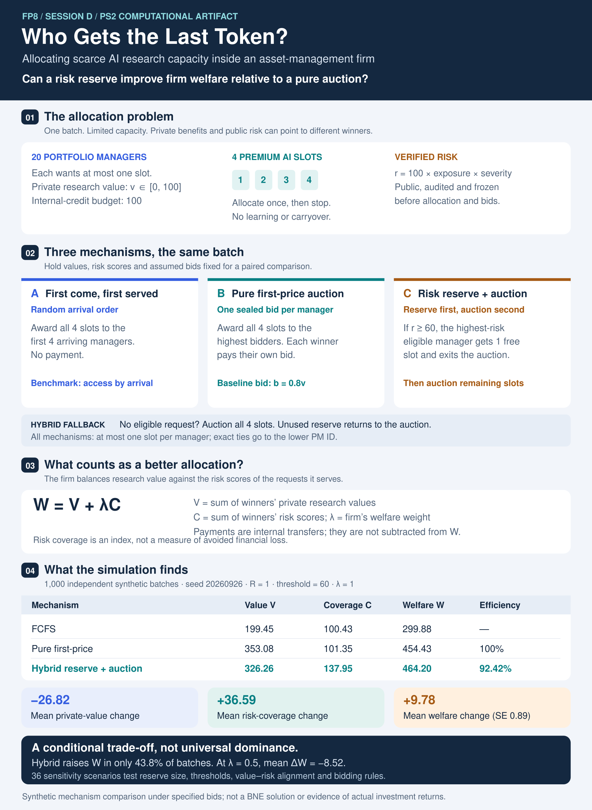

<div align="center">

# Auctions with Risk Reserves for Scarce AI Research

### When should an institution trade private-value efficiency for downside-risk coverage?

**Qianshuo (Aaron) Wang · Zhenning Wang**  
COMSCI/ECON 206 · Computational Microeconomics  
Professor Luyao Zhang · Duke Kunshan University · Autumn 2026  
**Team FP8**

**Baseline finding:** Across 1,000 matched synthetic batches, the hybrid mechanism
increases modeled welfare by **+9.78** at $\lambda=1$, but strictly improves welfare
in only **43.8%** of batches.

<p align="center">
  <a href="https://colab.research.google.com/drive/1I-J52wxGaAIwJK_LjtghBnXS2GxY0U2V"></a>
  <a href="https://huggingface.co/spaces/dku-comsci-econ206-2026/Final_Zhenning_Qianshuo_PM_Bid"></a>
  <a href="poster/final-poster.pdf"></a>
  <a href="paper/Final-FP08-Qianshuo-Zhenning.pdf"></a>
</p>

</div>

---
## Final Paper

[**View the full final paper (PDF)**](paper/Final-FP08-Qianshuo-Zhenning.pdf)

## Final Presentation Poster


[**View the full A0 poster (PDF)**](poster/FP08_Final_A0_Poster.pdf)

The final poster presents our research question, mechanism design, computational evidence, robustness checks, intellectual merits, practical impacts, and future research roadmap.

**Format:** A0 landscape (1189 × 841 mm)

---

> [!IMPORTANT]
> ### Conditional result — not universal dominance
>
> Across **1,000 matched synthetic batches** under the primary specification:
>
> | Outcome | Hybrid − Pure |
> |---|---:|
> | Private research value $\Delta V$ | **−26.82** |
> | Risk coverage $\Delta C$ | **+36.59** |
> | Welfare $\Delta W$ at $\lambda=1$ | **+9.78** |
> | Monte Carlo SE | **0.89** |
> | Break-even welfare weight $\lambda^*$ | **0.733** |
> | Batches with $\Delta W>0$ at $\lambda=1$ | **43.8%** |
>
> The hybrid therefore improves **mean modeled welfare under the baseline
> specification**, but it does not universally dominate the pure auction.

> [!NOTE]
> ### Evidence boundary
>
> All values and risk inputs are **synthetic**. The project is a mechanism
> comparison under specified bids, not a solved multi-slot Bayesian Nash
> equilibrium and not evidence about realized investment returns.
>
> The baseline bid rule $b_i=0.8v_i$ is a stylized simulation assumption.
> The risk score is a modeled, bid-independent input rather than an
> empirically validated operational financial-risk model. No simulated
> bids are treated as human behavioral evidence.

---

## Research Question

**Can a hybrid mechanism that combines auction-based allocation with reserved
capacity for objectively high-risk research requests improve the allocation of
scarce AI research capacity relative to a pure first-price auction?**

We study an active asset-management setting in which portfolio managers compete
for a limited number of premium AI research slots.

The central trade-off is between:

- **private research value**, represented by PMs' private values and bids; and
- **downside-risk coverage**, represented in the model by a public,
  bid-independent risk score.

For the hybrid mechanism $H$ relative to the pure auction $P$:

$$
W(H)>W(P)
\iff
\lambda \Delta C > L,
$$

where

- $\Delta C=C(H)-C(P)$ is additional risk coverage,
- $L=V(P)-V(H)$ is displaced private research value, and
- $\lambda$ is the firm's welfare weight on risk coverage.

The reserve is therefore justified only when the modeled value of additional
risk coverage is large enough to compensate for the private value it displaces.

---

## Mechanisms at a Glance

| Mechanism | Allocation | Payment | Role in Comparison |
|---|---|---|---|
| **Pure First-Price Auction** | Four highest bids receive the four slots | Winners pay their own bids | Private-value benchmark |
| **Hybrid Risk-Reserve Auction** | Up to one slot goes to the highest-risk eligible request; remaining slots are auctioned | Reserve winner pays 0; auction winners pay own bids | Proposed mechanism |
| **First-Come, First-Served** | First four requests in an exogenous random arrival order | No payment | Non-strategic reference |

Baseline hybrid policy:

$$
R=1,\qquad r^*=60.
$$

---

## Project Overview



The computational pipeline uses the same synthetic batch across mechanisms so
that Pure, Hybrid, and FCFS outcomes can be compared on matched requests.

---


## Research Artifacts

[Local behavioral Space source](hf_space/) · [Live Hugging Face Space](https://huggingface.co/spaces/dku-comsci-econ206-2026/Final_Zhenning_Qianshuo_PM_Bid). Behavioral evidence remains planned; the interface is exploratory.

| Artifact | Access | Status |
|---|---|---|
| **Canonical GitHub Repository** | This repository | Current |
| **Computational Notebook** | [Open in Google Colab](https://colab.research.google.com/drive/1I-J52wxGaAIwJK_LjtghBnXS2GxY0U2V) | Runnable |
| **Archived Notebook** | [`code.ipynb`](code.ipynb) | Available |
| **Hugging Face Space** | [Open behavioral interface](https://huggingface.co/spaces/dku-comsci-econ206-2026/Final_Zhenning_Qianshuo_PM_Bid) | Available |
| **Hugging Face Source** | [`hf_space/`](hf_space/) | Available |
| **Core Simulation** | [`simulation.py`](simulation.py) | Available |
| **Mechanism Tests** | [`test_simulation.py`](test_simulation.py) | Available |
| **Reproduction Script** | [`verify_reproduction.py`](verify_reproduction.py) | Available |
| **Verification Record** | [`verification.txt`](verification.txt) | Available |
| **Primary Summary** | [`primary_summary.csv`](primary_summary.csv) | Available |
| **Fresh Run Metadata** | [`fresh_run.json`](fresh_run.json) | Available |
| **Final Paper** | [View final paper](paper/Final-FP08-Qianshuo-Zhenning.pdf) | Available |
| **Final A0 Poster** | [PDF](poster/FP08_Final_A0_Poster.pdf) · [PNG](poster/FP08_Final_A0_Poster.png) · [Editable PPTX](poster/FP08_Final_A0_Poster.pptx) | Available |
| **Final Tested Release** | Final synchronized commit/tag to be recorded | Pending |
---

## Primary Computational Design

| Parameter | Primary Setting |
|---|---:|
| Portfolio managers | $N=20$ |
| AI research slots | $K=4$ |
| Credit budget | $M=100$ |
| Reserve slots | $R=1$ |
| Risk threshold | $r^*=60$ |
| Welfare weight | $\lambda=1$ |
| Private value | $v_i\sim U[0,100]$ |
| Exposure | $E_i\sim U[0,1]$ |
| Severity | $S_i\sim U[0,1]$ |
| Risk score | $r_i=100E_iS_i$ |
| Baseline bid rule | $b_i=0.8v_i$ |
| Matched synthetic batches | **1,000** |
| Random seed | `20260926` |

The same requests, values, risk scores, and bids are used across mechanisms
within each matched batch.

---

## Primary Results

Mean outcomes under the primary specification:

| Mechanism | Private Value $V$ | Risk Coverage $C$ | Welfare $W$ | Payments | PM Utility |
|---|---:|---:|---:|---:|---:|
| **Pure First-Price** | 353.08 | 101.35 | 454.43 | 282.46 | 70.62 |
| **Hybrid, $R=1$** | 326.26 | 137.95 | **464.20** | 226.98 | 99.28 |
| **FCFS** | 199.45 | 100.43 | 299.88 | 0.00 | 199.45 |

Relative to the pure auction, the hybrid:

- sacrifices **26.82** units of private research value;
- adds **36.59** units of modeled risk coverage;
- raises mean welfare by **9.78** at $\lambda=1$;
- has paired Monte Carlo SE **0.89**;
- has a mean break-even welfare weight of approximately
  **$\lambda^*=0.733$**.

At $\lambda=0.5$:

$$
\Delta W=-8.52.
$$

Moreover, the hybrid strictly improves welfare in only **43.8% of individual
batches** at $\lambda=1$.

The appropriate interpretation is therefore **conditional adoption**, not
universal superiority.

---

## Sensitivity Analysis

The computational artifact evaluates **36 scenarios** varying:

- risk threshold $r^*\in\{40,60,80\}$;
- reserve size $R\in\{1,2\}$;
- welfare weight $\lambda\in\{0,0.5,1,2\}$;
- value–risk alignment; and
- common versus heterogeneous bid shading.

At $r^*=60$ and $R=1$:

| Scenario | Mean Hybrid − Pure $W$ |
|---|---:|
| Common shading, positive rank alignment | 0.00 |
| Common shading, negative rank alignment | −3.24 |
| Heterogeneous shading, independent case | +13.12 |

These are **computational sensitivity results**, not observations of human
behavior.

The mechanism ranking depends on the welfare weight, value–risk relationship,
bidding assumptions, reserve size, and risk threshold.

---

## Run and Verify

Python 3.9+ is sufficient for the simulation and tests.

```bash
python3 -m unittest -v test_simulation.py
python3 simulation.py --seed 20260926 --batches 1000 --out results
python3 verify_reproduction.py
